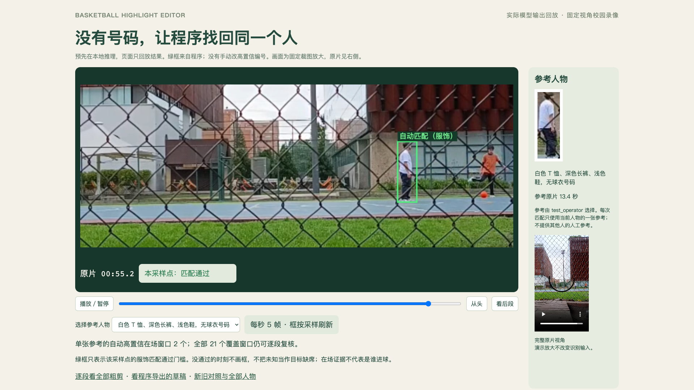

# 固定机位，无号码，单张参考自动找人

这次换成了固定视角的校园便装篮球录像。用户选定一张白色 T 恤、深色长裤的参考，程序从后段重新找回穿同一套衣服的人，再根据实际匹配证据自动导出草稿。没有号码 OCR、人脸识别或逐段手工指定高置信。

[看中文演示](automatic-fixed-demo/fixed-automatic-demo.mp4) · [打开结果回放](../examples/fixed-camera-automatic/recognition.html) · [看 6 秒自动草稿](../examples/fixed-camera-automatic/project/versions/automatic-draft-v2/reel.mp4) · [全部粗剪](../examples/fixed-camera-automatic/project/review-before-confirm.html)



## 输入与参考

原片为 Alejons06 的 [Cancha de basquetbol universidad](https://commons.wikimedia.org/wiki/File:Cancha_de_basquetbol_universidad.webm)，CC0，60.6 秒、478×850，固定视角，人物穿便装。使用仓库已有的[原片](../examples/unnumbered/sources/university.webm)和[许可记录](../examples/unnumbered/rights/university.json)，重新扫描 303 帧、492 个人形框。演示只做静态场地裁图放大；算法使用原片像素。

目标参考取自 13.4 秒，人形框为 `[327,413,350,481]`。这是 `test_operator` 的参考选择，不是逐回合标注。主演示每次只使用当前目标的一张参考，不给其他人物的人工参考。旧策略和新策略使用同一原片、参考、人形框和 21 个覆盖窗口，包括最后不足三秒的一窗。

## 实际结果

| 目标 | 旧策略高置信窗口 | 新策略高置信窗口 | 远离参考的窗口 |
| --- | --- | --- | --- |
| 白衣、深色长裤 | 0 | 2 | 51–54 秒、54–57 秒 |
| 绿上衣、蓝裤 | 0 | 1 | 0，当前只有参考附近通过 |
| 深蓝上衣、深裤 | 0 | 1 | 0，当前只有参考附近通过 |
| 橙上衣、深裤 | 0 | 1 | 0，当前只有参考附近通过 |

每位人物分别运行，只给其本人一张参考。切换回放页人物即可看对应的实际程序结果。数字是程序输出数量，不能当成准确率。两个白衣窗口相邻，属于同一次重新出现，不能算成两个独立成功实验。

程序排除目标参考前后三秒附近的窗口，再自动保留其余高置信窗口。实际留下 `c0018`、`c0019`，合成六秒[草稿](../examples/fixed-camera-automatic/project/versions/automatic-draft-v2/reel.mp4)。选择规则与程序生成的编号在[运行收据](../examples/fixed-camera-automatic/automatic-selection.json)；没有手工回填片段归属。

球员在场不等于他持球或得分。这段原片的篮筐不完整可见，因此使用覆盖窗口验证找人，不能将六秒草稿介绍为自动识别的进球集锦。

## 改动与误认

新入口在已有 YOLOX 人形检测后，使用本地 DINOv2-S/14 提取整套服饰、上半和下半纹理，同时检查颜色、清晰度及同画面竞争人物。每个高置信区间至少要有四个合格观测，跨度至少 0.8 秒。未知采样点保持未知；离开画面后重新比较，不凭轨迹直接延续身份。

轮换目标时，单张深蓝上衣参考曾把后段白衣判为高置信。加入独立的上衣颜色门槛后，该误认窗口不再通过；下装相似不能抵消上衣明显不同。代价是绿色上衣的部分后续区间也回到不确定。没有为了增加通过数量而放宽门槛。

`support_times` 列出实际通过点，`unresolved_times` 列出区间内没有通过的点。绿色框按采样点显示，不表示整段逐帧身份确认；结束时间按 EDL 的半开区间处理。

## 额外检查与失败

- 另一次从 Skill 说明出发的独立试用，使用不同 ROI 和覆盖窗口，重新跑人形及纹理推理，后段仍找到白衣。其看图记录全部是草稿；不是人工确认真值，也不能把相关采样点当成独立准确率样本。[记录](../examples/fixed-camera-automatic/independent-check/REPORT.md.txt)
- Gustavo Serrate 的 CC BY 3.0 [Basquete](https://commons.wikimedia.org/wiki/File:Basquete.webm)为另一段便装球局。新策略在 36 个窗口中给出 3 个高置信，旧策略 1 个；一个新窗口在参考附近。全局支持还出现在约 59、129、186 秒。镜头有移动和切换，只作为额外服饰检索检查。[来源与许可](../examples/fixed-camera-automatic/supplement/basquete/source/rights.json)
- 原先夜间移动的公园素材，当前仍是 0 个高置信、8 个不确定。原来的手工复核成片是历史示例，不再用作自动识别的主演示。[失败输出](../examples/fixed-camera-automatic/supplement/night-park/comparison.json)

## 本地复现与今晚使用

下载完整仓库，用包含 NumPy、OpenCV、ONNX Runtime 的 Python 执行：

```sh
python3 examples/fixed-camera-automatic/replay.py --output work/fixed-replay --render
```

默认读取带哈希的归档数值向量，重新计算匹配和自动选片，不需要纹理权重或 PyTorch。结果不是从保存的高置信编号复制过来的。

新视频需要已有官方 YOLOX 权重及合法 DINOv2-S 权重，首次纹理推理另需 PyTorch。模型不进仓库。参见[模型准备与运行](../skills/basketball-highlight-editor/references/appearance.md)。`--model /path/to/authorized/model.pth --redetect` 可以对本案例全新推理。

实际使用先检查固定背景和拍摄清晰度，选清晰参考，运行 `people --stream`、`match-people --role visible`、`select`、`rough`，同时复核高置信与不确定项。得分者和持球者仍需要独立证据。演示中的自动导出是用户授权的 `test_operator` 测试，没有生成用户逐段确认。

当前只证实了短片内这一类可见服饰检索有实际改进。没有新增人工 confirmed 评测集，也没有证实整场、换衣、相同穿着或长时间遮挡后的身份可靠性。完整门禁、模型许可和限制见[报告](reports/automatic-appearance.md)。
