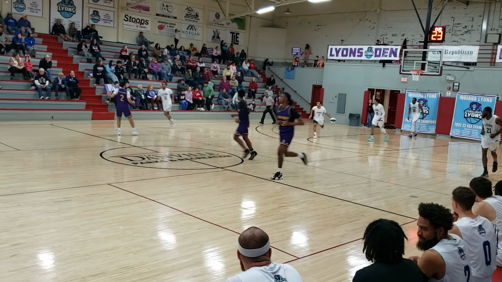
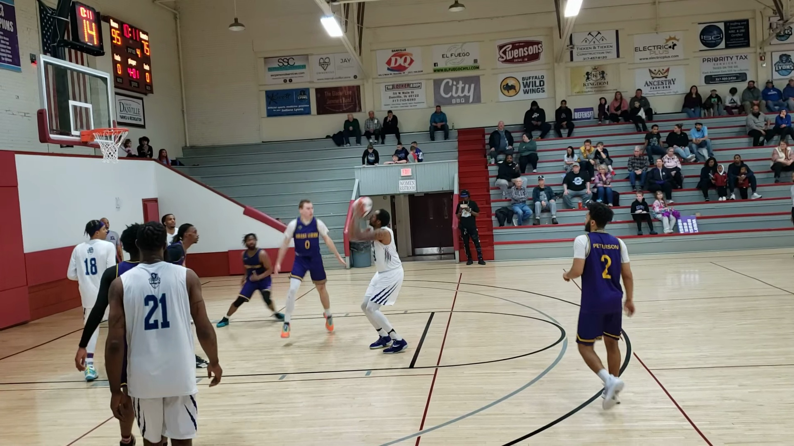
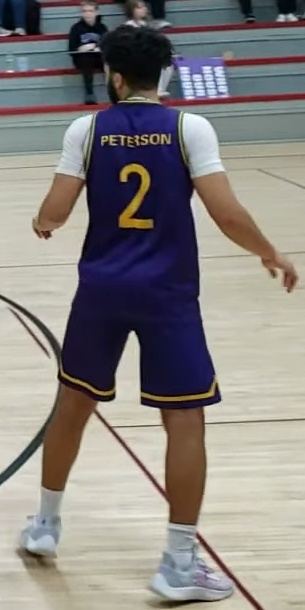

# 真实案例：从公开视频到等待下一条剪辑指令的项目

这份案例记录了一次实际执行，包括失败、人工选择和最终状态。所有链接对应仓库内的真实文件，不用虚构的高光结果代替测试。原始实验日期为 2026 年 10 月 27 日，时区为 America/Los_Angeles。

## 使用流程视频

<video controls preload="metadata" width="960" poster="demo/cover.png" src="demo/basketball-skill-demo.mp4">
  <a href="demo/basketball-skill-demo.mp4">播放或下载 Demo</a>
</video>

[播放／下载 1 分 52 秒演示](demo/basketball-skill-demo.mp4) · [口播稿与字幕说明](demo/README.md)

这是后续制作的公开案例重放，包含真实复核页和实际导出，配音为 AI；演示操作均为 `test_operator`，不是原用户操作实录，不改写下文的原始确认记录。

## 1. 输入是什么

视频来自 Wikimedia Commons 的 [Indiana Legends Versus Indiana Lyons](https://commons.wikimedia.org/wiki/File:Indiana_Legends_Versus_Indiana_Lyons,_20240224_183141_(165)_(165).webm)。作者为 Koavf / Justin Anthony Knapp，文件页标明自己的作品并以 CC0 1.0 提供。本仓库保留来源和作者；这不是任务用户本人的比赛，也不暗示画中人物参与或认可本项目。

| 项目 | 实际值 |
| --- | --- |
| 原视频 | [indiana-cc0.webm](../examples/indiana/source/indiana-cc0.webm) |
| 时长／画面 | 16.3 秒，1920×1080，30fps |
| 大小 | 16,425,066 字节 |
| SHA256 | `a0efebc2a31a793b70cb80e8c7fcff610658df6818f734d2e8ff2af0b0edb845` |
| 来源与发布说明 | [rights.json](../examples/indiana/source/rights.json) |
| 镜头条件 | 明显横移，多人遮挡，不是 BHE 理想的固定机位 |

本地优先的含义是视频分析、截图、OCR、跟踪和渲染脚本在本机执行，不把整段录像送入外部剪辑服务。原画面中的 Codex 视觉复核另外标为 `agent_visual_review`，不冒称由本地模型自动认出具体个人。

## 2. 先找疑似回合，第一轮并不好

使用的是已有 BHE v0.1.12 DMG 中的公开 `scan_video.py` 和 `generate_candidates.py`，没有安装 BHE GUI，也没有调用内部接口。相关 MIT 源码已转存到 [third_party/bhe](../third_party/bhe/)，并保留源码哈希。

第一轮用整个画面作为 ROI，以 10fps 采样，只有一个 6.55 秒附近的候选。原视频横移明显，估计的篮筐位置失真，这个候选不能直接算成进球。参见 [第一轮原始候选](../examples/indiana/experiments/full-frame/events.json)和 [日志](../examples/indiana/experiments/full-frame/run.log)。

请求 CoreML 也没有证明实际用了 CoreML；日志出现后端回落。因此后续明确使用 CPU，没有把设备请求包装成加速成功。

## 3. 调整 ROI，得到 4 个候选

第二轮检查画面后，把源像素 ROI 调整为 `[0,0,700,700]`，以 15fps、CPU 扫描。这个参数只适用于本视频，不是通用球场参数。

| 候选 | 事件时间 | 粗剪范围 | 真实复核结果 |
| --- | --- | --- | --- |
| c0001 | 2.63 秒 | 0 到 4.63 秒 | 目标球员可确认在场；穿框推断并不可靠，不能直接说他进球 |
| c0002 | 4.57 秒 | 1.57 到 6.57 秒 | 与 c0001 重叠，人物较远／模糊，进入待复核组 |
| c0003 | 11.57 秒 | 8.57 到 13.57 秒 | 接近实际投篮动作；目标球员主要在无球防守，白衣球员完成进攻 |
| c0004 | 12.43 秒 | 9.43 到 14.43 秒 | 与 c0003 重叠约 4.14 秒，不能当成独立高光 |

原始文件都在仓库中：[全部检测](../examples/indiana/project/detection/detections.json)、[事件](../examples/indiana/project/detection/events.json)、[运行日志](../examples/indiana/project/detection/run.log)。相同 CPU 参数重复运行，时间点完全相同，见 [重复运行记录](../examples/indiana/validation/reproducibility.json)。

**4 个候选不等于 4 个进球。** 这个案例同时展示了为什么还需要复核，而不是只展示一张“检测成功”的截图。

## 4. 自动特征是什么，哪些地方失败了

最初准备使用 OpenCV HOG，但 BHE 随包的 OpenCV 没有 `HOGDescriptor`。脚本当场失败后，改为“有 HOG 则用 HOG，否则只生成服饰颜色区域提议”。后备结果明确标为非已确认人体。

在 16 张完整采样帧上，后备方法生成了 639 个区域提议，其中有真实服饰，也有广告牌、观众和不完整裁图。号码 OCR 会错读或漏掉数字，结果全部保持 `verified: false`。

- [完整特征摘要](../examples/indiana/project/feature-summary.json)
- [全部 639 个区域裁图](../examples/indiana/project/crops/)
- [16 张原画面](../examples/indiana/project/frames/)

下面两张图分别能看到同队不同服饰的球员，以及目标球员在真实投篮回合中的位置。





没有用“紫色”直接把所有同队球员当成同一个人。最终归属检查记录在 [visual-review-evidence.json](../examples/indiana/project/visual-review-evidence.json)，包含检查者类型、时间、角色与证据说明。

## 5. 用户选人，同时提出无号码场景

候选和人物特征整理后，实际用户选择了“紫色 2 号”，并提醒真实比赛里大家可能没有号码。

这推动了样本流程的补充。目标在本视频中有这些可见服饰特征：紫色球衣与短裤、白色短袖内搭、双膝外露、白袜与白灰鞋。它们可以与穿黑色长护袖、黑色球鞋的同队球员区分，但不是可靠的跨比赛身份标识。



样本来自 9.5 秒的全身框。`sample` 保存图像、框、服饰描述，并尝试双向稀疏光流；这一步不读取号码 OCR，也不自动把候选升成高置信。

实际产生了 17 个短时跟踪提议，跨度为 8.9 到 12.3 秒。跟踪中断后停止，没有跨遮挡或镜头切换继续认人。[样本及跟踪记录](../examples/indiana/project/samples/s001-track.json)保留全部结果。后来用户明确确认了这张参考图，记录从 `test_operator` 转为 `user`，没有倒填原始确认状态。

另外跑了 `features --no-ocr`，得到 234 个颜色提议、0 个号码提示、0 个自动身份指派。[实测记录](../examples/indiana/validation/no-ocr-smoke.json)证明跳过号码的代码路径可运行。源视频本身仍有号码，因此这不能当作真实无号码整场比赛的识别评测。

## 6. 粗剪怎样交给用户二次删选

| 组别 | 视频 | 给用户看的说明 |
| --- | --- | --- |
| 高置信归属 | [c0001.mp4](../examples/indiana/project/rough/high_confidence/c0001.mp4) | 可确认目标球员在场，不确认 BHE 推断的进球 |
| 高置信归属 | [c0003.mp4](../examples/indiana/project/rough/high_confidence/c0003.mp4) | 目标主要是无球防守者，投篮来自白衣球员 |
| 待复核 | [c0002.mp4](../examples/indiana/project/rough/uncertain/c0002.mp4) | 重叠和画面模糊，需要决定是否保留 |
| 待复核 | [c0004.mp4](../examples/indiana/project/rough/uncertain/c0004.mp4) | 人物能确认，但可能是同一回合的重复候选 |

用户也可打开 [review.html](../examples/indiana/project/review.html)逐段看视频和证据，在本地表单选择保留／删除，下载决定 JSON。这个 HTML 不联网，GitHub 页面本身不执行表单脚本。本案例的实际决定来自聊天中的明确回复。

“高置信”指有证据支撑的候选归属，不是经统计校准的模型概率，也不保证这段值得做成高光。角色与归属需要分别看。

## 7. 真实确认后停在哪里

用户实际确认参考球员，保留 c0001、c0003，删除 c0002、c0004。[决定 JSON](../examples/indiana/project/review-decisions.json)保留了这个选择。

正式项目修订为 10，状态如下：

```json
{
  "state": "awaiting_edit_prompt",
  "revision": 10,
  "confirmation": {
    "reviewer_kind": "user",
    "kept": ["c0001", "c0003"]
  },
  "versions": []
}
```

完整 [project.json](../examples/indiana/project/project.json)与 [confirmed-edl.json](../examples/indiana/project/confirmed-edl.json)都已上传。删除的候选保留为可复核记录，但不会进入后续版本。正式项目目录没有合并成片，也没有借用户确认选片之机自动决定成片风格。

## 8. 后续不同版本如何验证

为了验证下一条 prompt 的能力，在**独立测试副本**中使用 `reviewer_kind: test_operator`，然后给两个明确的测试剪辑规格。它们不是用户要求发布的正式成片，正式项目仍保留空 `versions`。

| 测试规格 | 实际结果 | 文件 |
| --- | --- | --- |
| 倒序，先 c0003 再 c0001，EDL 上限 6 秒 | 容器时长 6.03 秒，差异来自帧／音频包取整 | [视频](../examples/indiana/test-versions/test-short/reel.mp4)、[EDL 与 prompt](../examples/indiana/test-versions/test-short/edl.json) |
| 原始时间顺序，保留两段完整内容 | 9.635352 秒，删除项未混入 | [视频](../examples/indiana/test-versions/test-long/reel.mp4)、[EDL 与 prompt](../examples/indiana/test-versions/test-long/edl.json) |

4 段粗剪和这 2 个测试版本均经过 FFmpeg 完整解码，输出 1280×720、30fps，保留音轨。行为测试还用静音合成源验证了不带音轨的导出。[媒体检查](../examples/indiana/validation/continuation-and-media.json)保留真实结果。

## 9. 如何复跑，如何读证据

在仓库根目录运行：

```sh
python3 scripts/verify_release.py
python3 -m unittest discover -s skills/basketball-highlight-editor/tests -v
python3 scripts/replay_case.py --output work/my-replay
```

这会重放已记录的 BHE／特征证据并重新切片。若需重跑检测，必须在自己有权使用的本地模型和依赖环境下调用 `detect --backend bhe`。模型未上传的原因见 [第三方说明](../THIRD_PARTY_NOTICES.md)，不能用重放结果冒充新一轮检测准确率。

原始实验 14 项行为测试通过。开源版在此基础上增加了相对源路径的跨目录渲染测试，让项目从仓库下载到其他电脑后也能定位原视频。完整逐轮失败记录位于 [test-log.md](../examples/indiana/validation/test-log.md)。

公开导出时，把本机用户名和绝对路径换成占位符，将源视频引用改成相对路径，并记录新的公开案例用途。原候选时间、帧、裁图、选择、确认状态和媒体内容没有为了演示效果而改写；所有导出文件的校验值随发布包提供。

## 10. 这个案例没有证明什么

它没有证明能自动识别用户本人，也没有测量完整比赛的进球准确率、身份切换率、无号码球员识别准确率或全部回合召回率。固定机位、唯一可见服饰会更容易；同款衣服、遮挡、多机位和画面切换仍可能需要人工判断。

这个项目当前提供的是有状态、有证据、有人工确认点的辅助剪辑流程。无法区分的片段会留下来让人决定，不会为了让演示“全自动成功”而强行分配身份。
