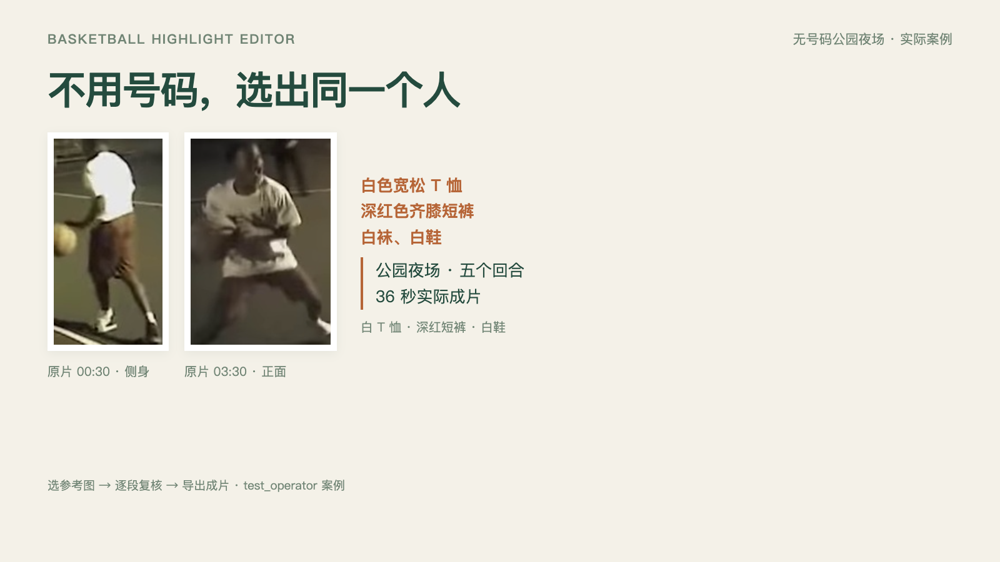
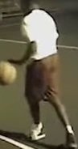
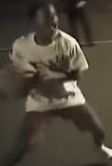

# 无号码公园夜场：从选人到实际成片

> 历史案例：这段为移动机位，八个窗口均不确定，后续由 test_operator 手工复核。当前自动识别与固定机位主演示见[新案例](AUTOMATIC_FIXED_CASE.zh-CN.md)。

这次重新换了一段录像，没有沿用 Indiana 的号码球衣、候选或成片。画面是公园里的临时篮球局：球员穿便装或光膀子，移动机位、夜间照明，没有号码球衣。目标是白色宽松 T 恤、深红色齐膝短裤、白袜白鞋的球员。

## 先看剪出来的结果

[播放／下载 36 秒成片](../examples/park-unnumbered/project/versions/unnumbered-chronological/reel.mp4) · [看选人到导出的操作演示](unnumbered-demo/unnumbered-workflow.mp4) · [下载后打开实际复核页](../examples/park-unnumbered/project/review-before-confirm.html)

成片保留现场声与原片水印，按原片时间顺序剪接，没有添加音乐或伪造跟踪框。它包含运球、接球突破、篮板和出手；没有把所有出手标成进球。

## 用什么认同一个人

| 00:30 的侧身参考 | 03:30 的正面参考 |
| --- | --- |
|  |  |

比较的是白色宽松上衣、深红色短裤和白袜白鞋，结合短时间内的连续画面；没有读取号码，也没有使用人脸识别。另保存深色衣服、光膀子球员的对照参考，避免只让系统在唯一一个人选里作答。

两张参考与选片决定由 `test_operator` 代做。用户这次授权我选择素材、选人并剪辑，不代表用户逐段确认了这个公开测试人物。这些记录不是评测 ground truth，没有新增 `eval/` 的 confirmed 标注。

## 这次实际经过哪些步骤

1. 下载新的公有领域原片，保存来源、作者、许可和 SHA256。先看整段的连续抽样画面，排除号码球衣场景。
2. 对原片 0–391 秒以 3 fps 重新运行 YOLOX-Nano 人形检测和现有 clothing-v2 服饰特征提取。固定 ROI 只裁掉发布者已有的左右模糊填充边栏；不固定篮筐，不读取号码。原片末尾约 0.7 秒没有纳入扫描。
3. 先保存每 12 秒一个的覆盖窗口，再由测试操作员整理出八段便于演示的待选回合，其中三段是其他球员持球的删除对照。**这里使用的是覆盖与操作员整理，不是自动检测进球的成功案例。**
4. 保存两张目标参考和两张对照参考，使用现有归属策略重新运行 `match-people --role visible`。保留原始匹配结果与不确定项，不更改阈值，不把人物在场升级成得分者归属。
5. 生成八段独立粗剪，按原画面与参考图复核。保留五段，删除三段；随后按本次明确的剪辑要求导出 36 秒顺序版本。

[全片扫描工程](../examples/park-unnumbered/analysis/project.json)、[原始人形与特征记录](../examples/park-unnumbered/analysis/people/detections.json)、[自动分组](../examples/park-unnumbered/automatic-selection.json)、[候选归属证据](../examples/park-unnumbered/project/people/candidate-proposals.json)与[操作员选片记录](../examples/park-unnumbered/project/review-decisions.json)都可以核对。

**实际自动结果是高置信 0 段、不确定 8 段。** 服饰匹配有部分帧级支持，但没有任何一个完整候选通过当前严格门槛；没有把人工看图结果冒称为模型自动识别成功。

## 留了什么，删了什么

| ID | 原片时间 | 决定 | 画面内容 |
| --- | --- | --- | --- |
| c0001 | 00:25–00:32 | 保留 | 白衣球员运球，侧身和背面服饰可对照 |
| c0002 | 01:39–01:49 | 保留 | 白衣球员运球后出手，机位跟随篮球 |
| c0003 | 03:17–03:27 | 保留 | 白衣球员接传球、运球推进 |
| c0004 | 04:37.5–04:41.5 | 保留 | 白衣球员篮下接球、转身移动 |
| c0005 | 04:49–04:54 | 保留 | 白衣球员外线出手，随后机位转向篮筐 |
| c0006 | 00:44–00:49 | 删除 | 主要是光膀子球员持球 |
| c0007 | 01:30–01:35 | 删除 | 光膀子球员运球 |
| c0008 | 05:48–05:54 | 删除 | 光膀子球员持球 |

这是五个可复核的参与回合，没有声称找到这名球员的全部进球。快速横移、遮挡和模糊画面仍需人工看；自动不确定的结果没有被悄悄改成高置信。

## 如何换成自己的录像

给 Codex 录像路径，并说明有权处理：

> 用这个 Skill 整理这段野球录像。大家都没有号码。先给我看参考球员和候选，别直接合成。

在参考图中指出目标：

> 我要白 T 恤、深红短裤、白鞋这位。用这两张图作参考。遮挡或认不准的也给我看。

打开粗剪复核页，决定每段保留或删除。保存后再给剪辑要求：

> 把我留下的片段按时间顺序剪出来，保留现场声音，不加音乐。

本例演示录屏里的填表动作没有提交为 `user`。实际保存的决定一律是 `test_operator`，见 JSON；没有伪造你的确认。

## 来源、许可与复现

原片由 Cocoa PD 制作，[Commons 来源页](https://commons.wikimedia.org/wiki/File:Bodycam-_Florida_Police_Officers_Joins_Kids_in_Basketball_Game.webm)明确标为美国公有领域（PD Florida）。原始拍摄日期为 2017-01-19，本次下载日期为 2026-10-28。使用官方 480p VP9 转码，854×480，约 6 分 32 秒。[原片](../examples/park-unnumbered/source/park-bodycam.webm)和[完整许可／SHA256 记录](../examples/park-unnumbered/source/rights.json)随案例保留。

复现说明见[案例 README](../examples/park-unnumbered/README.md)。源代码、选片输入、参考框、扫描参数、原片和导出规格均保存；不提交模型权重。新案例不修改 Indiana 原始确认工程、评分逻辑、正式标注或 hold-out 划分。
