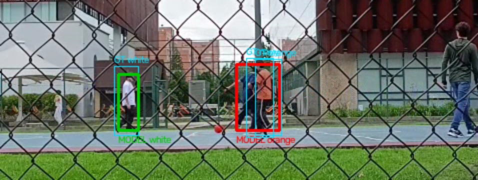
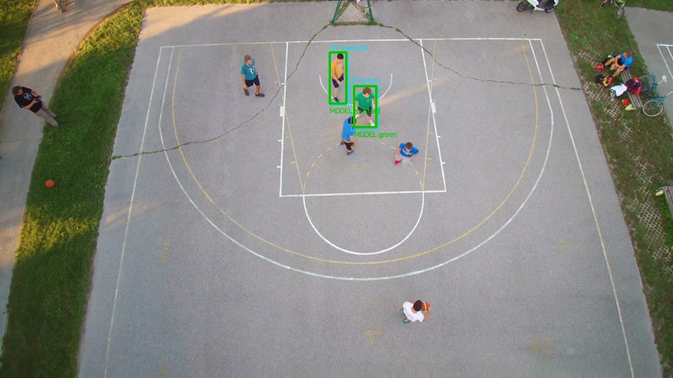
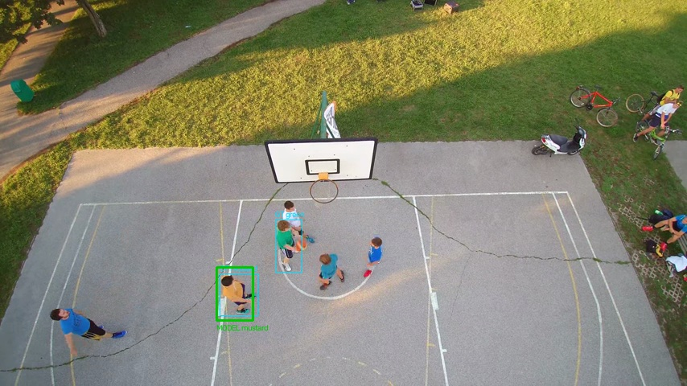

# 无号码篮球选人实测

这次补上了真实的人体检测、服饰样本匹配和短时轨迹，不再只靠颜色区域提议。大学球场的四名便装球员，以及公园比赛中的绿上衣、芥末黄上衣球员，都不需要号码来选人。两个场景的随机留出时间点通过了预先设定的短片测试门槛。

**这是一套经过短片测试的辅助选片方法。没有完成整场比赛的独立验证，也没有训练一个通用身份识别模型。** 相似服饰、遮挡和切镜仍会造成漏检或误认；本文直接保留失败结果。下列标注、选人和确认都来自 Codex 作为 `test_operator` 的视觉复核，不是新的人类用户答复。

## 素材怎么来的

从可公开处理和再分发的 Wikimedia Commons 素材中寻找大学、街球、公园录像，保留了五个文件、四个拍摄场景。它们不是从所有篮球视频中等概率抽到的代表性样本。冻结算法后，使用固定种子 `20261028`，在两段视频内另抽取各 12 个未参与调参的整秒时间点。抽样结果及冻结代码哈希在 [holdout-selection.json](../examples/unnumbered/holdout-selection.json)。这是同一视频内的时间点留出，不是新的独立球场。

| 来源 | 作者、许可 | 实际用途 |
| --- | --- | --- |
| [大学球场，60.6 秒](../examples/unnumbered/sources/university.webm) | Alejons06，CC0 | 四名无号码便装球员；隔网拍摄，人物交叉、出画和重新入画 |
| [Ljubljana 公园，约 200 秒](../examples/unnumbered/sources/ljubljana480.webm) | Detlef Stöcker，CC BY 3.0 | 分析篮球段 129–189 秒，包含航拍和镜头变化；目标绿、黄上衣无可读号码，其他球员中有号码球衣 |
| [乌克兰街球，20.7 秒](../examples/unnumbered/sources/ukraine.ogv) | Viktor O. Ledenyov，CC BY-SA 4.0 | 两个暖色上身、不同短裤目标的困难对照；不能确认所有衣服都无号码，不计入纯无号码成功组 |
| [莫斯科街球 1](../examples/unnumbered/sources/moscow1.webm)、[2](../examples/unnumbered/sources/moscow2.webm) | Predatorsamsung，CC BY 4.0 | 同一场景的隔网、远景、运动模糊筛查；混有号码球衣。保留检测输出，没有把它们列成成功识别案例 |

原始作者、原页面、许可链接、字节数和 SHA256 都在 [source-registry.json](../examples/unnumbered/source-registry.json) 及 [rights](../examples/unnumbered/rights)。乌克兰原视频横倒，提供了[旋转后的派生视频](../examples/unnumbered/sources/ukraine-upright.mp4)，继续使用 CC BY-SA 4.0。相应帧、标注图和剪辑沿用来源媒体许可；根目录 MIT 不替代媒体许可。

## 具体改了什么

旧版 `features` 在缺少 HOG 的环境中只能提出颜色区域，容易把围栏、标牌和观众放进人物列表。新增 `people` 使用官方 YOLOX-Nano ONNX，在整幅球场 ROI 与重叠小块上检测人体，合并重复框。检测置信分数只用于人体提议，不能当作身份概率。

每名目标保存一到两张明确选择的全身样本。匹配器比较近似上衣、袖部、短裤和鞋袜区域的颜色分布，压低中性背景的影响，并降低亮度变化的权重。它不运行号码 OCR，不使用脸部嵌入。服饰区域是按人体框比例划分的近似区域，不能保证任意姿势下都完全避开头部或背景。

匹配器把相邻检测连接成短轨迹，要求空间位置、框大小和服饰都相容；存在相近的竞争连接时断开，超过 0.71 秒的检测间隔也断开。轨迹通过校准样本锚点，或至少三次一致的服饰匹配，才产生支持证据。冲突锚点、相似球员和单帧偶然色块留在不确定项。这些规则减少漂移，但没有构成经过独立测量的切镜检测器。

一个候选片段至少需要三次支持观测、跨越至少 0.5 秒，才能进入模型支持的目标出现组。该归属只表示目标出现在候选里，`role` 固定为 `merely_visible`。它没有证明该人投篮、进球或助攻。选片仍需逐段复核，确认后保存 EDL，等待下一条剪辑指令。

## 从失败到当前版本

人体检测与身份匹配分开测量。第一次普通 HSV 分区匹配在航拍里只找回 2/18 个可见目标帧。改成背景抑制的服饰特征后找回 13/18，但产生了一次误认；加入短轨迹共识后达到 16/18，未发现误认。

以下各版使用相同的最终评分规则重新计算。每个预测框除了与自己身份的真值 IoU ≥ 0.35，还必须与自己身份最相符，避免两个人交叉时一个大框被当作认对任意一人。

| 开发场景 | v1 普通 HSV，精度 / 召回 | v2 服饰加权，精度 / 召回 | v3 加短轨迹，精度 / 召回 |
| --- | --- | --- | --- |
| 大学球场 | 100% / 80.8% | 91.3% / 80.8% | 95.5% / 80.8% |
| 公园航拍 | 100% / 11.1% | 92.9% / 72.2% | 100% / 88.9% |
| 乌克兰困难对照 | 75% / 37.5% | 60% / 37.5% | 100% / 50% |

[统一评分结果 JSON](../examples/unnumbered/validation/ablation-consistent-scoring.json) 保留实际计数。历史初版 JSON 仍在，不能把旧评分与修订评分混用。大学球场标注曾出现拼图边界坐标抄错，逐张原画审计后修正；旧标注和审计原因全部保留在 `university-truth-v0.json`、`university-truth-v1.json` 和 [最终开发标注](../examples/unnumbered/university-truth.json)。这些开发标注修订不是留出集测试成功的依据。

大学球场 6 秒处的交叉就是当前仍存在的错误。青框是真值，红框是归属错误的模型框，绿色是正确模型框。红框覆盖了两个人，评分把它计成一次误认和一次漏检。



## 冻结后的随机时间点结果

冻结 v3 后才抽取新时间点、查看原画标注，再运行身份匹配评分。校准帧不参与评分；无法从原画核实的严重遮挡或极窄画边碎片标成 `unknown`，单独列出，不算成正确或错误。仍可辨认的半身、弯腰与交叉帧没有因为失败而删除。

| 场景 | 正确 / 误认 / 漏检 | 精度 | 可见目标召回 | 人体检测召回 |
| --- | --- | --- | --- | --- |
| 大学球场 | 14 / 0 / 3 | 100% | 14/17，82.4% | 17/17，100% |
| 公园航拍 | 22 / 0 / 2 | 100% | 22/24，91.7% | 23/24，95.8% |
| 合计 | 36 / 0 / 5 | 36/36，100% | 36/41，87.8% | 40/41，97.6% |

预设门槛为精度至少 95%、可见目标召回至少 80%。这两个场景分别通过了门槛。大学留出集共 48 个球员×时间点，其中 5 个真值无法核实，实际评分 43 个；17 个可见、26 个不在画面。公园留出集为 24 个可见球员帧，没有排除项。

公园 146 秒处，绿上衣与芥末黄上衣都得到正确支持：



漏检也可以逐项查。大学 19、24、26 秒的白上衣目标在画边；公园 157 秒漏掉绿上衣，177 秒漏掉黄上衣。下面 157 秒的青框仍然显示绿上衣真值，模型没有强行填一个归属。



[大学留出结果](../examples/unnumbered/validation/university-holdout.json)、[公园留出结果](../examples/unnumbered/validation/ljubljana-holdout.json) 含每个时间点的框、预测和状态。[原画网格帧](../examples/unnumbered/groundtruth-frames) 可核对坐标。标注由 Codex 视觉复核，并无独立人工审计；帧之间高度相关，样本数也小。36 次预测没发现误认不等于真实精度必然为 100%，更不能外推为整场比赛的准确率。

## 跑完整选片流程

这次除了评估，还从原始视频重新跑了集成版 YOLOX 检测，生成两套可打开的完整项目。候选是事先声明的覆盖窗口，没有冒充 BHE 进球检测结果。

| 项目 | 模型支持 / 不确定 | 测试复核后保留 | 保存状态 |
| --- | --- | --- | --- |
| [大学项目复核页](../examples/unnumbered/university-project/review.html) | 2 / 4 | c0001、c0002 | `awaiting_edit_prompt`，无成片版本 |
| [公园项目复核页](../examples/unnumbered/ljubljana-project/review.html) | 6 / 0 | 六个覆盖窗口 | `awaiting_edit_prompt`，无成片版本 |

大学项目选绿外套和牛仔裤的球员。系统将开始的两个窗口列为模型支持，其余四个保留为不确定；测试操作者查看原片后保留前两段，删除其余四段。[第一段粗剪](../examples/unnumbered/university-project/rough/high_confidence/c0001.mp4)、[第二段粗剪](../examples/unnumbered/university-project/rough/high_confidence/c0002.mp4) 可直接下载观看。公园项目同样选绿上衣，六个窗口中确有该目标，但不能把“这个窗口有他”理解为“窗口内每帧都认对他”。

[大学 EDL](../examples/unnumbered/university-project/confirmed-edl.json)、[公园 EDL](../examples/unnumbered/ljubljana-project/confirmed-edl.json)、每次匹配、参考裁图、短轨迹、检测框和完整复核决定都已保存。两个新项目的确认人均为 `test_operator`。原紫衣 2 号的真实用户项目仍是原修订 10，保留 c0001、c0003；没有被这些实验改写。

## 本地复现

需要已经存在的 Python 3.10+、NumPy、OpenCV、ONNX Runtime、FFmpeg/FFprobe。仓库包含官方 YOLOX-Nano 模型、Apache-2.0 许可、来源哈希和参考推理源码；不需要再下载该模型，不安装整套 YOLOX 或 Ultralytics。模型来源和许可依据见 [provenance.json](../skills/basketball-highlight-editor/assets/yolox/provenance.json)。

```sh
# 重新算身份预测，逐项对比冻结实验；无网络请求
python3 scripts/evaluate_unnumbered.py --output work/benchmark

# 从原始视频重新检测，再跑样本、选人、粗剪、测试确认
python3 scripts/replay_unnumbered.py --scene university --output work/university --redetect
python3 scripts/replay_unnumbered.py --scene ljubljana --output work/park --redetect

# 已有检测可重放，省去再次人体推理
python3 scripts/replay_unnumbered.py --scene university --output work/university-replay

python3 -m unittest discover -s skills/basketball-highlight-editor/tests -v
python3 scripts/verify_release.py
```

`--output` 必须使用新的目录。测试重放不会编造用户答复，也不会自动制作正式成片。集成版从原片重跑的开发／留出评分计数与表中一致。按原始精确时间解码，与缓存按三位小数时间重新提取特征相比，大学有 4/182、公园有 141/180 个采样记录的距离或接受项发生差异，不能声称逐帧输出完全相同；详见 [fresh-run 记录](../examples/unnumbered/validation/integrated-fresh-run.json)。25 项行为测试已通过。完整运行记录在 [validation](../examples/unnumbered/validation)，所有实验版本源码在 [experiment-code](../examples/unnumbered/experiment-code)。大体积原始检测 JSON 使用标准 gzip 压缩，解压后可直接检查；仓库的重跑脚本自动读取。

## 还需要继续验证的部分

相似服饰的乌克兰对照仍只找回 4/8 个可见目标帧，没有过召回门槛。莫斯科远景隔网素材没有足够可靠的目标真值，保留为筛查失败，没有编造准确率。同色队友、长遮挡、低分辨率和切镜后换视角都可能让当前方法失效，遇到这些情况应增加明确参考样本并人工复核。

本次最长的身份分析区间约一分钟。整场比赛的身份切换次数、长期跟踪、独立人工标注、跨设备和跨球场泛化仍未建立。下一步需要更长、可公开且有人工真值的比赛，再验证这些指标。这些空缺不能靠删除一句说明补上。
