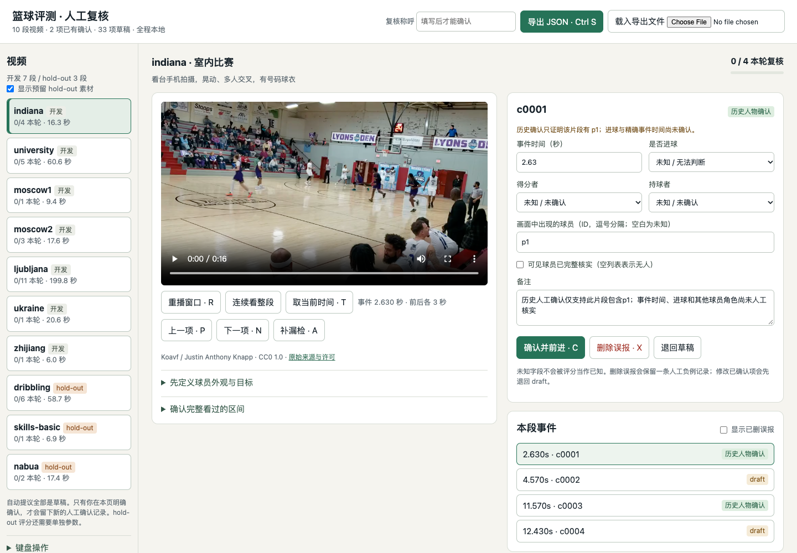
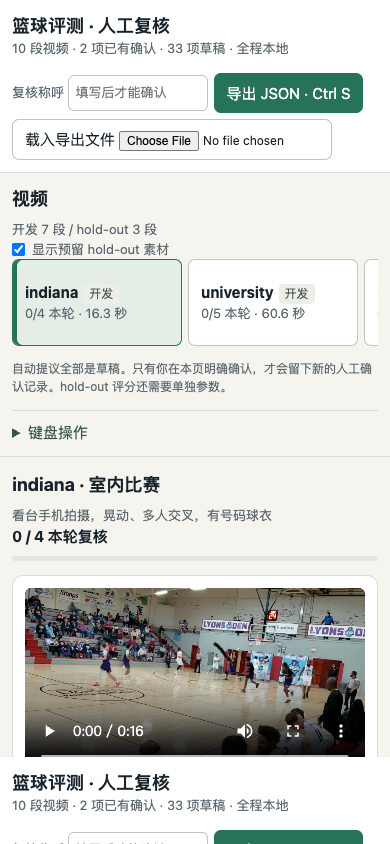
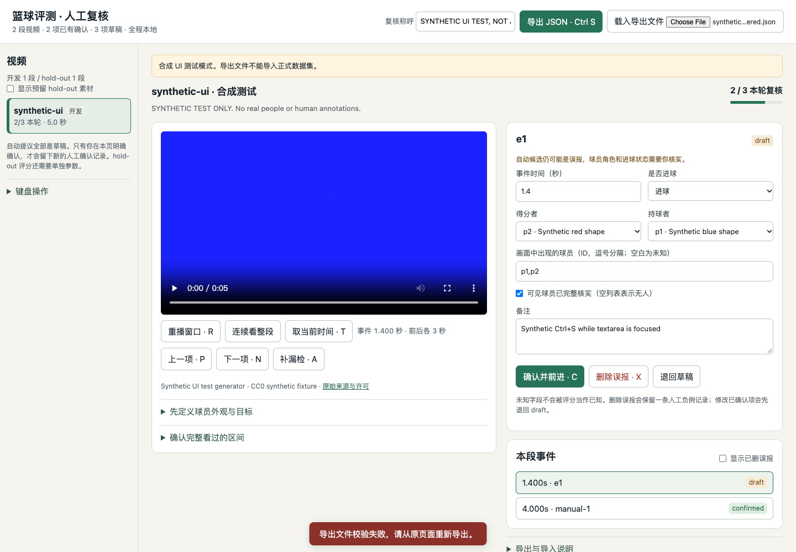

# Goal 1：评测基建与离线人工标注

已完成本次基建和素材收集。工作在本地 `goal-1-eval` 分支，多次提交，没有推送或修改 main。没有替用户确认任何真实新标注。

上一轮目标也已重新核对：v1.1.0 仍为公开发布，提交 `93fc9063787ec5b9f09b0977d7e3bfc71cd62fbe`，完整 ZIP 为 197,257,830 字节，服务器 SHA256 为 `37b096ec7a06f1d286280be8052d61eaa25fae695d88ff0eca455638386a6a48`，与上轮本地收据一致。原项目仍是修订 10。

## 你早上需要做的事

1. 用 Chrome 或 Edge 打开 [review.html](../../eval/review.html)。在仓库根目录可运行 `open -a "Google Chrome" eval/review.html`，不需要启动服务器。
2. 填写复核称呼，先把 p1、p2 的自动外观提议改成真实可核对的服饰描述，并设置目标 ID。
3. 逐个播放事件前后各 3 秒。C 确认，X 删除误报，A 补漏检；输入框内用 Ctrl Enter。时间、得分者、持球者和可见球员分开核实，未知就留空。
4. 连续看完原片／建议区间，补齐漏检后再明确确认完整复核区间。只 review 候选无法知道检测遗漏了多少。
5. Ctrl S 导出 JSON，再按下列命令导入。需要标预留集时，在左侧勾选“显示 hold-out”。

```sh
python3 eval/import_review.py --file /path/to/basketball-review.json
python3 eval/build_review.py
python3 eval/score.py --output work/development-scores.json
# 最终决定评测预留集时才显式开启：
python3 eval/score.py --include-holdout --output work/final-scores.json
```

完整操作、键盘说明、标注结构和导入后的 Git 步骤见 [eval/README.md](../../eval/README.md)。浏览器自动保存不代替导出备份。导入器会核对原片、预览副本和导出内容的 SHA256；不会把 draft 升级为 confirmed。

## 做了什么

- 收集并固定 10 段明确许可的视频，7 段 development、3 段 hold-out。8 段在户外，只有 Indiana 是室内比赛，另有一段室内运球示范。
- 复用了现有 6 段许可原片，新下载 4 段，避免重复文件。共 9 个拍摄组，莫斯科两段属于同组且都在 development。三段 hold-out 来自新收集的独立来源组。
- 对全部视频运行／复用现有 BHE 候选和 `features --no-ocr`，产生 26 个检测候选与 9 个补充复核窗口，共 35 条自动 draft。补充窗口没有混入检测预测。
- 建立逐事件结构，分别保存时间、是否进球、得分者、持球者、可见球员、状态与确认字段。确认项必须有页面来源、确认人、会话和时间；可见性不冒充投篮或得分归属。
- 完成单 HTML 离线页面：视频切换、前后窗口、时间与球员修改、删除误报、补漏检、退回草稿、进度、键盘、自动保存、导入导出。修改已确认事实或补漏检会使相关复核区间重新待确认。
- 实现 `eval/score.py`，只读已锁定的人工事实，采用 ±1 秒的最大一对一匹配，输出机器 JSON 和单行摘要。开发与 hold-out 分开，后者必须显式参数。
- 实现原片和播放副本的哈希保护、导出校验、confirmed 文件登记及锁定。篡改、缺失或未登记的 confirmed 文件会使评分返回退出码 2。评分绝不自动刷新锁。
- 本轮没有下载、添加或修改模型权重。使用已有的本地 BHE 只读运行时；从 v1.1.0 继承的权重没有进入本轮差异。没有安装新 Python 包。

## 视频清单与许可

| ID / split | 秒数 | 作者 | 许可与来源 | 拍摄条件 | 检测 / draft |
| --- | ---: | --- | --- | --- | ---: |
| indiana / development | 16.3 | Koavf / Justin Anthony Knapp | [CC0 1.0](https://commons.wikimedia.org/wiki/File:Indiana_Legends_Versus_Indiana_Lyons,_20240224_183141_(165)_(165).webm) | 看台手机拍摄，晃动、多人交叉，有号码球衣 | 4 / 4 |
| university / development | 60.6 | Alejons06 | [CC0](https://commons.wikimedia.org/wiki/File:Cancha_de_basquetbol_universidad.webm) | 竖屏手机，隔铁网，便装无号码，人物出入画 | 0 / 5 |
| moscow1 / development | 9.4 | Predatorsamsung | [CC BY 4.0](https://commons.wikimedia.org/wiki/File:Streetball_in_Moscow_Bolshoy_Spasoglinishchevsky_lane.webm) | 竖屏晃动、隔网远景、车辆和立柱遮挡、邻近活动区域 | 0 / 1 |
| moscow2 / development | 17.6 | Predatorsamsung | [CC BY 4.0](https://commons.wikimedia.org/wiki/File:Streetball_in_Moscow_Bolshoy_Spasoglinishchevsky_lane2.webm) | 同一拍摄事件的第二段；移动镜头，杂乱服饰及相邻区域 | 3 / 3 |
| ljubljana / development | 199.8 | Detlef Stöcker | [CC BY 3.0](https://commons.wikimedia.org/wiki/File:Sportpark_Ljubljana_-_Skateboard_and_Basketball_Aerials_by_Yuneec_Typhoon_Q500_4k.webm) | 航拍，连续视角变化，多个相邻场地、普通上衣与号码球衣混合 | 11 / 11 |
| ukraine / development | 20.6 | Viktor O. Ledenyov | [CC BY-SA 4.0](https://commons.wikimedia.org/wiki/File:(2)_BASKETBALL_GAME_IN_TOWN_OF_BAR_REGION_OF_VINNYTSIA_STATE_OF_UKRAINE_VIDEO_BY_VIKTOR_O_LEDENYOV_20160507.ogv) | 手机低分辨率，镜头移动、逆光，已转正90度，球衣号码状态未核实 | 1 / 1 |
| zhijiang / development | 6.0 | Ambassador of the United States of America to the People's Republic of China | [Public domain](https://commons.wikimedia.org/wiki/File:Ambassador_Nicholas_Burns_plays_basketball_with_Chinese_students_in_Zhijiang_Dong_Autonomous_County.webm) | 户外学校球场，手机短片，便装，公众活动背景，约6秒 | 1 / 1 |
| dribbling / holdout | 58.7 | Mart570 | [CC BY-SA 3.0](https://commons.wikimedia.org/wiki/File:Basketball-Basic_Types_of_Dribbling.webm) | 室内低机位近距离运球示范；作为非进球与误报对照，不是完整比赛 | 6 / 6 |
| skills-basic / holdout | 6.9 | Azorbli | [CC BY-SA 4.0](https://commons.wikimedia.org/wiki/File:Basketball_(1).ogv) | 加纳土质场地，低清晃动，简单篮架、杂色便装、练习回合 | 0 / 1 |
| nabua / holdout | 17.4 | Yawrei | [CC BY-SA 4.0](https://commons.wikimedia.org/wiki/File:Nabua_street_basketball_WTR.webm) | 菲律宾路边自制篮板篮筐，地面不平、强烈明暗对比、便装，无可读号码 | 0 / 2 |

逐文件下载日期、原片／预览 SHA256、字节数、许可链接和拍摄组见 [catalog.json](../../eval/data/catalog.json)，原始许可记录与派生说明见 [RIGHTS.md](../../eval/data/RIGHTS.md)。四段新视频全部允许再分发；本轮没有采用必须保留在本地的限制性素材。日后此类素材必须放到被忽略的 `eval/local-media/`。

源码按根目录 MIT；视频、帧、预览副本分别保留来源许可，包括 CC BY-SA 3.0／4.0 的相同方式共享要求。程序许可不替代媒体许可。

## 评分与 Indiana baseline

[baseline JSON](../../eval/baselines/indiana.json) 和 [单行摘要](../../eval/baselines/indiana-summary.txt) 已生成。

| 指标 | baseline | 实际分母与边界 |
| --- | --- | --- |
| 高置信归属正确率 | 1.000 | 两个历史人工确认片段中的 p1 出现事实，2/2 |
| 目标事件进入高置信或不确定组 | 1.000 | 这两个已确认片段，2/2 |
| 高置信覆盖率 | 1.000 | 这两个已确认片段，2/2 |
| 事件精确率、召回、F1 | null / N/A | 原用户没有确认进球或精确事件时间，不能制造数值 |

唯一历史迁移从原始用户决定文件读取 c0001、c0003 的 p1 出现事实，来源诚实写为 `legacy_indiana_user_review`，附原文件哈希。没有伪装成新的 review 页面确认。此例外由本任务 E 项要求支持，仅限两个片段的人物出现字段；c0002、c0004 的编辑性删除没有被误当成“该球员不在画面”或“未进球”的真值。

所有新生成的 35 条记录仍是 draft；页面开始时显示两个历史人物事实和其余草稿，但本轮完整事件复核进度为 0。旧的 agent/test_operator 无号码实验没有进入本次 gold。评分遇到未知字段会跳过，并报告分母；不会把未复核预测默认当作误报。

## 测试结果

| 检查 | 结果 | 证据 |
| --- | --- | --- |
| 新评测、格式、哈希锁、导入与语料保护单元测试 | 50 项通过 | [日志](goal-1-assets/eval-tests.txt) |
| 原仓库状态、媒体、人物匹配测试 | 25 项通过 | [日志](goal-1-assets/original-tests.txt) |
| 原始案例 replay_case.py | 通过，输出在隔离 work 目录 | [日志](goal-1-assets/replay.txt) |
| 原 review 表单逻辑 | 通过 | [日志](goal-1-assets/original-review-form.txt) |
| 原片 SHA256 | 10 段通过 | [日志](goal-1-assets/source-verification.txt) |
| verify_release.py | 通过，发布清单已更新 | MANIFEST.sha256 与最终校验 |
| confirmed 篡改拒绝 | 通过 | CLI 测试修改临时合成确认文件后返回 2，未触碰真实记录 |
| 原 Indiana 用户项目 | 671 个文件字节哈希完全一致 | [冻结清单](../../eval/data/protected-indiana.json) |
| main / 新模型权重 | main 保持原提交；本轮权重变更为 0 | [机器审计](goal-1-validation.json) |

可在仓库根目录复现：

```sh
python3 -m unittest discover -s eval/tests -v
python3 -m unittest discover -s skills/basketball-highlight-editor/tests -v
python3 scripts/verify_release.py
python3 scripts/replay_case.py --output work/new-replay
```

本机评分测试使用 Python 3.10.6；原有视觉测试复用 BHE Python 3.11 的依赖。CI 模板加了新测试与 baseline／replay 步骤，但没有创建远端 workflow、启用 CI 或推送分支。通过结果均来自本机实测。

## 页面 QA

Browser 插件及 browser skill 未提供，因此按前端测试规则使用已有 Playwright 和本机 Chrome。测试采用独立临时浏览器配置，不读取用户 Chrome 配置。页面通过 file:// 打开，没有本地服务器，也没有任何 HTTP／HTTPS 请求。视口为桌面 1440×1000 和移动 390×844。

| 检查 | 结果 |
| --- | --- |
| 页面标题、有效内容、非空白、无框架错误遮罩 | 通过 |
| JS 异常与错误 console | 0 |
| 自动外网请求 | 0 |
| 十段真实视频加载、尺寸与播放时间前进 | 全部通过；只读检查 |
| 时间／球员修改，Ctrl Enter 确认，误报删除，新增漏检 | 合成视频上通过 |
| 区间确认，修改后事实与区间退回待确认 | 合成视频上通过 |
| 不离开输入框的自动保存，聚焦输入时 Ctrl S，重载恢复 | 合成视频上通过 |
| 正常 JSON 导入、篡改 JSON 拒绝、错选视频哈希拒绝 | 合成视频上通过 |
| 桌面与移动排版，横向溢出 | 通过，无横向溢出 |

交互顺序为：打开真实页面逐个播放十段素材；切到明确显示“合成 UI 测试模式”的隔离页面，修改时间与球员、确认、删除、补充、确认区间、修改退回、自动保存、导出、导入、刷新，并验证篡改和错选文件被拒绝。自动确认没有接触真实视频草稿，合成导出也被正式导入器拒绝。完整检查见 [UI 结果 JSON](goal-1-ui-result.json)。

## 未完成的部分与后续

- 没有代替你标真实视频，也没有新的人工确认进球真值。因此真实事件 P/R/F1 暂时无法估计，人物 baseline 也只是两个历史片段。你早上 review、补漏检并确认区间后，就能直接评分。
- 这些片段多数较短，包括土场练习、公众活动和运球负例，不等于十场独立完整比赛。语料尚不支持宣称整场识别可靠。
- hold-out 没有人工标签，也没有在本轮计算识别准确率；其自动候选与播放测试不属于模型调参。
- 本轮未优化检测或身份模型，新的目标 ID 在用户校准前没有高置信人物预测。若要比较新模型，请单独导出预测，保持人工真值和锁不变。
- 已测试 Chrome；Safari、Firefox、移动真机和多用户并行编辑尚未验证。页面依赖本地目录完整和浏览器存储，导出文件才是可移交的进度。
- 普通 JSON 来源和哈希不是人类身份数字签名。它们防止静默误改，并提供可审计记录；真实人工复核仍是确认的依据。
- 没有任何部分因连续一小时无进展而被跳过。网络初期遇到沙箱 DNS／Python 根证书问题，改用系统 curl 正常校验证书后完成下载；浏览器检查按授权使用隔离无头 Chrome。

## 截图

以下真实页面截图使用 Indiana 的 CC0 视频；合成交互图只含生成的测试色卡，不作为篮球识别证据。






